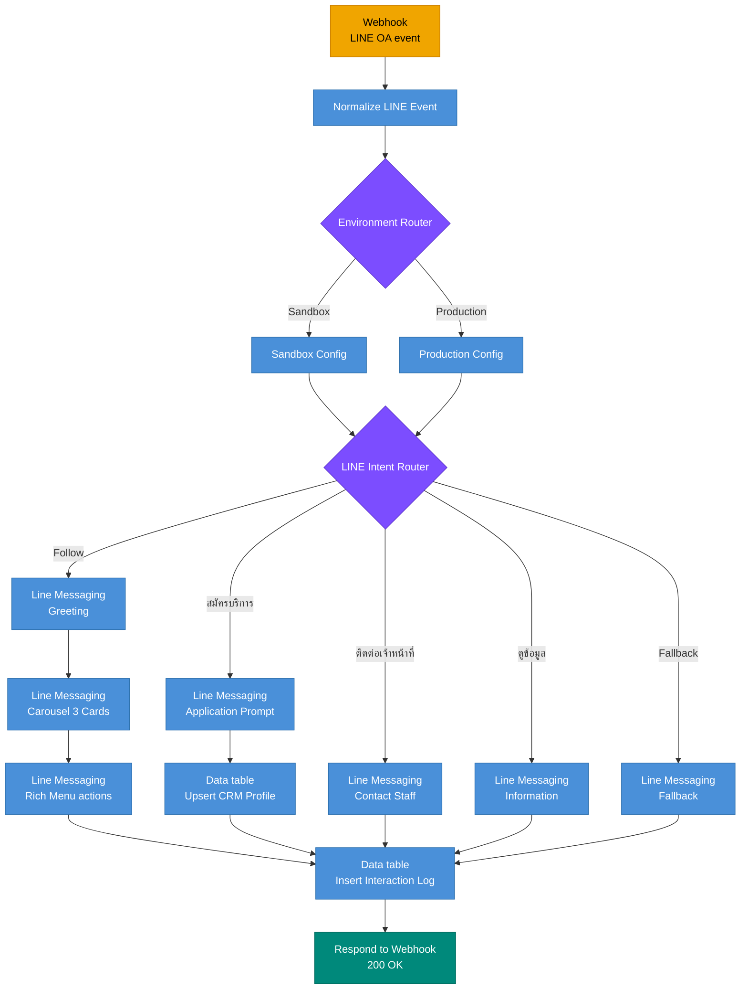

# Workflow - LINE OA CRM Sandbox Flow

## Status
- Status: Built, inactive
- Approval date: 2026-08-02
- n8n Workflow ID: `8wdSUTbfkJ5QaKMu`
- Active/Published: no
- Workflow URL: https://n8n-j4e3.srv1194412.hstgr.cloud/workflow/8wdSUTbfkJ5QaKMu

## Original Requirements
- Trigger: LINE OA webhook
- Services: LINE OA and n8n Data Tables
- Inputs: LINE event, userId, replyToken, message/postback, environment
- Logic: Greeting, carousel 3 cards, Rich Menu 3 actions, service application flow, CRM tag `CRM`, Sandbox/Production routing
- Outputs: LINE OA replies and Data Table records
- Error handling: planned retry/error log path
- Constraints: initial storage in n8n Data Tables; full version planned at approximately 30–40 nodes

## Assumptions
- Environment defaults to `sandbox` unless supplied in the webhook event.
- `userId` is the CRM matching key.
- Final CRM fields, carousel images, and admin LINE ID remain pending.

## Approved Mermaid

## Quick Build Reference
| # | n8n Node | Operation | Notes |
|---|---|---|---|
| 1 | Webhook | POST | `/webhook/line-oa-crm` |
| 2 | Set | Manual | Normalize LINE event fields |
| 3 | Switch | Rules | Sandbox / Production and intent routing |
| 4 | Line Messaging | `reply` | `@aotoki/n8n-nodes-line-messaging.lineMessaging` |
| 5 | Data table | `upsert` | CRM profile by `userId` |
| 6 | Data table | `insert` | Interaction log |
| 7 | Respond to Webhook | JSON | Return HTTP 200 |

## Required LINE node convention

สำหรับทุก workflow ที่เกี่ยวข้องกับ LINE OA ให้ใช้ community node นี้เป็นค่าเริ่มต้น:

`@aotoki/n8n-nodes-line-messaging.lineMessaging`

ใช้ operation ที่เหมาะสม เช่น `reply`, `send`, `getProfile`, `multicast`, `showLoadingAnimation` และใช้ credential type `lineMessagingApi`.

ไม่ใช้ HTTP Request หรือ built-in `n8n-nodes-base.line` แทนเมื่อ Line Messaging รองรับ operation นั้นอยู่ เว้นแต่ผู้ใช้ระบุเป็นกรณีพิเศษ

## Data Tables
- `line_oa_crm_profile` — `KVMgZ7AGq49H9BMw`
- `line_oa_interaction_log` — `vHBEHOIQy0xGLO9c`
- `line_oa_error_log` — `PjLIunLlrRjlKjkc`

## Build Verification
- Validation: workflow code validated successfully; latest update returned no validation warnings
- Test execution: pending LINE end-to-end test
- Result: workflow created and inactive; LINE Messaging nodes attached to credential `นายสมเสร็จ`

## Related Knowledge
- [[MOC - Workflows]]
- [[Pattern - Webhook to Database]]
- [[Pattern - Chatbot Workflow]]
- [[Node - Webhook]]
- [[Node - Switch]]
- [[Node - Set (Edit Fields)]]
- [[Node - HTTP Request]]
- [[Best Practice - Credential Management]]

## Build/Edit History
| Date | Change | Result |
|---|---|---|
| 2026-08-02 | Approved design and created Data Tables | Complete |
| 2026-08-02 | Created 16-node LINE OA scaffold via n8n MCP | Complete |
| 2026-08-02 | Replaced LINE HTTP Request nodes with Line Messaging nodes | Complete; latest workflow has 17 nodes |
| 2026-08-02 | Added this workflow note to the n8n knowledge vault | Complete |

## Pending Items
- [ ] Add LINE Channel Secret signature validation
- [ ] Finalize CRM fields
- [ ] Add carousel image URLs and final copy
- [ ] Configure actual account-level Rich Menu
- [ ] Add retry/error path and admin LINE ID
- [ ] Run Sandbox end-to-end test
- [ ] Activate Production only after safeguards pass

> ห้ามเก็บ token, password, private key หรือ credential value ในไฟล์นี้
> อ่านไฟล์นี้ก่อน Build/Edit ครั้งถัดไป
> Source of truth: this file for the workflow record; n8n holds the executable workflow.

## Official Docs
- https://docs.n8n.io/integrations/builtin/core-nodes/n8n-nodes-base.webhook
- https://docs.n8n.io/build/work-with-data/data-tables
- https://docs.n8n.io/integrations/builtin/core-nodes/n8n-nodes-base.datatable
- Community node: `@aotoki/n8n-nodes-line-messaging.lineMessaging`
- Node operation reference verified through n8n node type definitions
- n8n best practices: Webhook development, Data Persistence
- n8n MCP server: `search_nodes`, `get_node_types`, `validate_node_config`

Last updated: 2026-08-02
"}