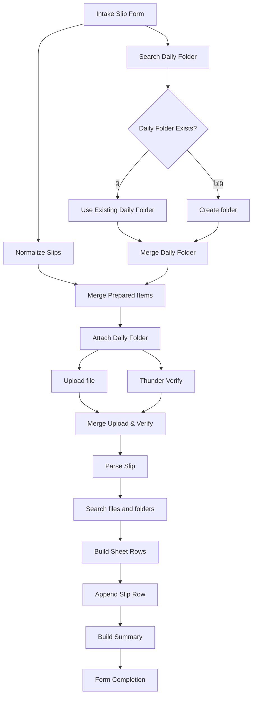

# Pattern - Multi-file Slip Intake Node Connections

## Problem
รับสลิปหลายไฟล์จาก n8n Form, ตรวจสอบด้วย Thunder, อัปโหลดทุกไฟล์ไป Drive และบันทึกผลลง Google Sheets โดยต้องรักษา item/binary pairing และแสดงผลสรุปเพียงครั้งเดียว

## Workflow Shape



## Connection map

| ลำดับ | จาก node | ไป node | เหตุผล/ข้อมูลที่ส่งต่อ |
|---:|---|---|---|
| 1 | [[Node - Form Trigger]] `Intake Slip Form` | [[Node - Code]] `Normalize Slips` | แยก binary หลายไฟล์เป็น 1 item ต่อ 1 slip |
| 2 | `Intake Slip Form` | [[Node - Google Drive]] `Search Daily Folder` | ใช้ `submittedAt` หาโฟลเดอร์ `YYYY-MM-DD` |
| 3 | `Search Daily Folder` | `Daily Folder Exists?` | ตรวจว่าผลค้นหามี `id` หรือไม่ |
| 4 | `Daily Folder Exists?` true | `Use Existing Daily Folder` | แปลงผล Drive เป็น `dailyFolderId` |
| 5 | `Daily Folder Exists?` false | `Create folder` | สร้างโฟลเดอร์วันใหม่ใต้ parent |
| 6 | สองทาง folder | [[Node - Merge]] `Merge Daily Folder` | รวมผล folder เดิม/ใหม่เป็น stream เดียว |
| 7 | `Normalize Slips` + `Merge Daily Folder` | `Merge Prepared Items` | join binary หลาย item กับ folder metadata เดียว |
| 8 | `Merge Prepared Items` | [[Node - Code]] `Attach Daily Folder` | เติม folder ID ให้ทุก slip และ preserve `pairedItem` |
| 9 | `Attach Daily Folder` | `Upload file` | อัปโหลด binary ทุกไฟล์ โดยใช้ `sourceFile`/`dailyFolderId` |
| 10 | `Attach Daily Folder` | [[Node - HTTP Request]] `Thunder Verify` | ส่ง binary เดิมไปตรวจ Thunder v2 |
| 11 | `Upload file` + `Thunder Verify` | [[Node - Merge]] `Merge Upload & Verify` | combine ตามตำแหน่ง เพื่อรวม Drive metadata กับผลตรวจ item เดียวกัน |
| 12 | `Merge Upload & Verify` | [[Node - Code]] `Parse Slip` | parse rawSlip, classify และสร้าง link/status ในจุดเดียว |
| 13 | `Parse Slip` | `Search files and folders` | ค้นหา monthly spreadsheet ตามเดือน/ปี พ.ศ. |
| 14 | `Search files and folders` | `Build Sheet Rows` | จัดรูปข้อมูลต่อ item ให้ตรงกับหัวคอลัมน์ |
| 15 | `Build Sheet Rows` | [[Node - Google Sheets]] `Append Slip Row` | append จริง/ปลอม/ซ้ำ/ไม่ใช่บัญชี พร้อม link/status |
| 16 | `Append Slip Row` | `Build Summary` | ให้ summary เกิดหลังการเขียน Sheet เสร็จ |
| 17 | `Build Summary` | `Form Completion` | ส่งข้อความรวมเพียงครั้งเดียวกลับหน้า Form |

## Data contract

### หลัง `Normalize Slips`
```text
json.sourceFile
binary.data
```

### หลัง `Attach Daily Folder`
```text
json.sourceFile
json.dailyFolderId
json.dailyFolderName
binary.data
pairedItem
```

### หลัง `Parse Slip`
```text
json.transRef
json.amount
json.senderName
json.receiverName
json.receiverAccount
json.receiverProxy
json.slipLink
json.sourceFile
json.result
json.slipVerification
```

### สถานะมาตรฐาน
| result | slipVerification | ความหมาย |
|---|---|---|
| `success` | `จริง` | ตรวจผ่านและผู้รับเป็นบัญชีคลินิก |
| `invalid` | `ปลอม` | ไม่มี raw slip หรือ Thunder แจ้ง error |
| `duplicate` | `ซ้ำ` | Thunder แจ้ง duplicate slip |
| `not_shop_account` | `ไม่ใช่บัญชีคลินิก` | ผู้รับไม่ตรง allow-list |

## Why this wiring works
- Form แตกเป็นสองสายเพื่อไม่ให้ Drive folder search ทิ้ง binary
- `Merge Prepared Items` รวม binary กับ folder metadata ก่อน upload
- Upload และ verify ทำขนานกัน แต่ `Merge Upload & Verify` จับคู่กลับด้วย position
- Parse/classify ใน Code เดียว ลด IF/tag/merge ซ้ำ
- Google Sheets เป็น persistence path ส่วน Build Summary เป็น presentation path ที่รอ append เสร็จ
- ไม่มีการอ้าง `$('Upload file').item` ข้าม branch หลัง merge

## Gotchas
- `Merge` แบบ Position ต้องรักษาลำดับ item ของ upload และ verify ให้ตรงกัน
- Code node ที่สร้าง item ใหม่ต้องส่ง `pairedItem`
- อย่าใช้ `.first()` กับข้อมูลต่อสลิป เช่น binary, filename, sender หรือ parsed result
- `Build Summary` ควรอ่าน `$('Parse Slip').all()` เพราะ output จาก Google Sheets อาจไม่คง field เดิม
- `sheetName` ใน `Build Sheet Rows` ใช้แสดงวัน (`1`–`31`) ส่วน routing จริงยังใช้ day-to-GID mapping
- ชื่อหัวคอลัมน์ภาษาไทยต้องตรง Unicode: `ลิงค์สลิป` ไม่ใช่ `ลิ้งค์สลิป`
- Manual run ที่ Form Completion อาจเป็น `waiting`; ทดสอบผ่าน Form URL เพื่อยืนยัน response จริง

## Related Patterns
- [[Pattern - Error Handling with Error Trigger]]
- [[Pattern - Multi-file Slip Intake Node Connections]]

## Related Workflow
- [[Workflow - Income Slip Intake LINE to Thunder]]

## Related Nodes
- [[Node - Form Trigger]]
- [[Node - Code]]
- [[Node - Merge]]
- [[Node - HTTP Request]]
- [[Node - Google Drive]]
- [[Node - Google Sheets]]
